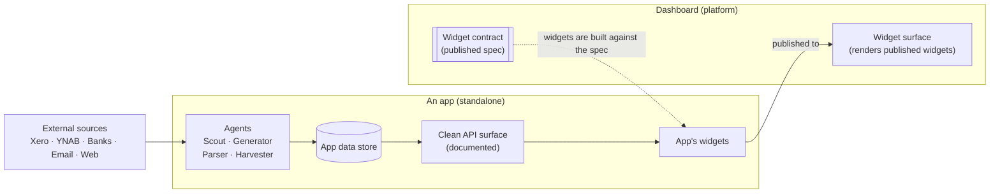

# famdash architecture

famdash is a **platform of standalone apps** that surface into a shared
**dashboard**. This document describes how the pieces fit together.

## The shape of the system

There are three kinds of thing in famdash:

- **The dashboard** — a platform/host that renders widgets on a shared surface
  and publishes the **widget contract** that apps build against.
- **Apps** — self-contained products (Money, School, Chores, …). Each harvests
  its own data, can stand alone, exposes a clean API, and owns the widgets it
  publishes to the dashboard.
- **Agents** — the workers inside apps that do the data work. Every agent is
  one of four types: **Scouts, Generators, Parsers, Harvesters**.

Read the diagram left to right: external sources feed an app's **agents**, which
land data in the app's **store**; the app exposes that data through a clean,
documented **API**; the app builds **widgets** against the dashboard's
**contract** and publishes them; the dashboard **renders** them on its surface.

## Principles

### 1. Apps are standalone
Each app is a complete product on its own. It has its own data, its own logic,
and its own reason to exist independent of the dashboard. The dashboard is a
*consumer* of apps — an app never depends on the dashboard to function.

Consequences:
- An app can be developed, deployed, and used without the dashboard.
- An app failing or being offline degrades only its own widgets, not the
  dashboard or other apps.

### 2. Apps harvest their own data
Each app owns the full path from source to storage: ingestion, normalization,
and persistence. That work is done by the app's **agents** (see
[`agents.md`](agents.md)). No shared, central ingestion pipeline — data
ownership lives with the app that understands the domain.

### 3. Apps expose a clean, documented API
Every app publishes an **API surface** with clean docs. This API is the single
way data leaves the app — the app's own widgets read through it, and so can
anything else. Because the API is documented and stable, widgets are thin: they
call the app's API and render.

### 4. The dashboard publishes the widget contract
The dashboard owns **one spec**: the widget contract. It defines how a widget
is declared, discovered, mounted, sized/placed, and fed data — the shared shape
every widget must fit. The dashboard publishes this contract; it does **not**
reach into apps. See [`widget-contract.md`](widget-contract.md).

This is an inversion of control: the platform defines the slot, the apps fill
it. The dashboard needs no app-specific code to render an app's widget.

### 5. Apps own and publish their widgets
A widget belongs to the app, not the dashboard. The app:
- builds its widget(s) **against the dashboard's contract**,
- reads its own data through its **own API**,
- and **publishes** the widget so the dashboard can discover and render it.

The dashboard arranges and renders published widgets; it doesn't own their
content or their data.

### 6. Agents do the data work
Inside each app, the actual fetching/creating/parsing/syncing is performed by
**agents** of four types — Scouts, Generators, Parsers, Harvesters. The agent
taxonomy is a first-class part of the architecture: it gives every app a common
vocabulary for the kind of data work it does. See [`agents.md`](agents.md).

## The two contracts

famdash holds together on two clean interfaces. Keeping them clean is what lets
apps stay standalone while still composing into one dashboard.

| Contract | Owned by | Written against by | Purpose |
|----------|----------|--------------------|---------|
| **App API** | each app | the app's widgets (and any other client) | how data leaves an app |
| **Widget contract** | the dashboard | every app's widgets | how a widget plugs into the dashboard |

An app's widget therefore sits at the meeting point of both contracts: it is
built against the **dashboard's widget contract** and gets its data from the
**app's own API**.

## Data flow (end to end)

1. **Ingest** — an app's agents pull/parse/generate/harvest from external
   sources (or create content) on a schedule or trigger.
2. **Store** — normalized data lands in the app's own store.
3. **Expose** — the app serves that data through its documented API surface.
4. **Publish** — the app publishes widgets built against the dashboard contract.
5. **Render** — the dashboard discovers published widgets and renders them,
   each widget pulling live data from its app's API.

## Why this shape

- **Independent evolution** — apps ship on their own cadence; the dashboard
  only depends on the widget contract, not on app internals.
- **Clear ownership** — each app owns its data, API, agents, and widgets, so
  there is one obvious place for every concern.
- **Composability** — new apps join by publishing widgets against the same
  contract; the dashboard doesn't change to accommodate them.
- **Resilience** — a failing app degrades to just its own widgets.

## Implementation snapshot (MVP)

A runnable Next.js dashboard host now lives at the repo root (not a rewrite of
the product model above). It adds:

- Clerk authentication and an env-based email allowlist for `/dashboard`
- Typed stub feed clients for **bukz** and **FamPoll** (placeholders until live
  APIs are wired)
- No production deploy / Preview until Security (Cipher) reviews

See [`mvp.md`](mvp.md) for routes, env vars, and next steps. The long-term
shape in this document still stands: standalone apps, app APIs, widget
contract, and agents.

## Open questions / to confirm

- **Chores → Apollo Sign** _(tentative)_: transcription and exact role of
  "Apollo Sign" (e.g. a sign-off/approval integration for completed chores) to
  be confirmed, along with the Chores app's agent type.
- Transport and discovery mechanics of the widget contract (how widgets are
  published and discovered at runtime) are intentionally left open here — see
  [`widget-contract.md`](widget-contract.md).
- Exact bukz / FamPoll API shapes once credentials and docs are available.
